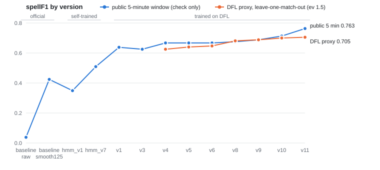

# Ball possession from automatic tracking

**The DataFellas** — More Than A Hack 2027, Phase 1. Submission `dfl_sup_v11`
(sha256 `8bca9a4bf0ca846775818fc8d707723f82a9e00893184fa26674e85a8d727744`).

**In one paragraph.** We compute about 170 per-frame features from the automatic tracking (ATD).
Gradient-boosting classifiers and two temporal convolutional networks turn them into per-frame
probabilities of home, away and dead ball. A three-state hidden Markov model decodes the averaged
probabilities into possession spells, with a turnover detector setting, frame by frame, how much a
change of team costs. The competition match has labels for five minutes only, so every model learns
from the **DFL / Sportec open data**: seven Bundesliga matches with corrected tracking and a
provider possession label, degraded until they look like the ATD. Every design choice was made on
this DFL validation proxy, scored with the official metric code. No label of the provided game was
used to train anything, and nobody hand-labelled or hand-corrected anything on it. The public five
minutes served as a pipeline check and as a dead-ball guard fixed in advance (section 3). The file
regenerates bit for bit.

---

## 1. Approach, and why

### 1.1 What spellF1 rewards

spellF1 matches predicted and true possessions one to one by IoU and averages F1 over IoU 0.3–0.7;
a 2 s possession counts as much as a 60 s one. Two consequences drove the design:

- **Flicker is fatal.** A frame classifier that is right 95% of the time still invents hundreds of
  one-frame possessions (the unsmoothed official baseline scores 0.04 on the public window). A
  temporal decoder is required.
- **Merges cost more than splits.** Missing two short possessions inside a long one (A–H–A–H–A
  decoded as A) loses up to three true matches and adds a false one; a spurious cut usually leaves
  the larger half matched.

### 1.2 Why train on another league

Seventeen public possessions can check a pipeline but cannot train it or choose between versions:
within one five-minute window, sampling noise alone moves spellF1 by about ±0.09. Our first system
self-trained on rule-based pseudo-labels from the match itself (0.478 on the proxy). Its weakness is
structural: the rules need the ball, which is missing on 41% of graded frames, so live play without
a ball is never learned. The DFL open data (Bassek et al., 2025, CC-BY 4.0) carries a per-frame
`BallStatus` and `BallPossession` — the same kind of label as the competition's — on clean tracking.
We remove the ball in simulation and keep the label.

### 1.3 Pipeline

```
ATD (+ broadcast ball) ─► features (+ extra) ─► classifiers + temporal networks ─► P(H, A, D)
                       ─► HMM with frame-dependent switching cost (Viterbi) ─► CSV
```

| stage | what it does | code |
|---|---|---|
| loading | ATD into arrays in metres; video frame *i* = row *i* | `possession/tracking.py` |
| broadcast ball | broadcast tracking located on the tactical timeline by matching players (one offset per half); fills some tactical ball gaps | `possession/align.py` |
| features | ~150 per frame, in a "home attacks +x" frame: ball state and gaps, ball–player distances, restart geometry, kick/exit events, team shape and speeds, rolling means over ±0.5 s and ±1.5 s | `possession/features.py` |
| extra features | four families (section 1.6): last ball position before a gap, goalkeepers, restart taker, where each team runs to | `possession/extra_features.py` |
| classifiers | `HistGradientBoostingClassifier`, a *seen* model (ball known) and a *blind* one (only features that exist without a ball) — one model learned the shortcut "no ball → dead" | `possession/supervised.py` |
| home/away split | P(dead) from the plain classifiers, the home/away split of live play from classifiers with past/future context | `possession/pipeline.py`, `possession/context.py` |
| temporal networks | two TCNs (section 1.5), averaged with the classifiers | `possession/sequence.py` |
| turnover detector | binary classifiers: "does the team in possession change within ±0.5 s?" (section 1.4) | `possession/turnover.py` |
| decoder | 3-state HMM, mean stay 15 s, evidence scaled by 0.25 (neighbouring frames are not independent), Viterbi | `possession/decode.py` |
| export | `H`/`A`/`D` on graded frames, `X` elsewhere; frames before the published second-half kickoff are `D` | `scripts/make_submission.py` |

### 1.4 Making DFL look like the ATD, and labelling it like the competition

**Noise.** `possession/noise.py` degrades the clean tracking with the ATD's defects: ball gaps with a
median of about 10 s, more frequent at stoppages and in slow play; a ball rarely seen near the lines;
strong ball smoothing; player dropouts; low-frequency position error. The preset was **calibrated on
label-free, whole-match aggregate statistics** of the competition features (distance between proxy
and match from 5.58 to 1.52). Each DFL match enters training three times, under the preset and two
perturbations of it (domain randomisation).

**Labels.** DFL's possession flips on every touch (17% of its spells last under a second); the
competition counts a change only on *controlled* possession. A live spell shorter than 1.5 s is given
back to the team before it, unless a **control event of its own team** falls inside it (pass, shot,
interception, duel won with the ball). The live-typed events drift by a few seconds, so each is moved
within ±5 s to the frame where its player is closest to the ball (the alignment idea of ETSY, Van Roy
et al., 2023); 98–99% are synchronised. Restart spells are always kept.

**A switching cost that depends on the frame.** A plain HMM charges every change of team the same
price, which makes a real one-second possession pay two switches and favours merging it. A detector
trained on frames within ±0.5 s of a home↔away change (AUC 0.89–0.93 on held-out matches) sets the
transition probability frame by frame:
`P(H→A at t) = (1/375 · 0.75) · odds(detector_t)^γ`, γ = 1 — an input-dependent HMM in the spirit of
Bengio & Frasconi (1995). Transitions to and from dead ball are unchanged.

### 1.5 Temporal networks

The classifiers see one frame plus hand-chosen windows. A temporal convolutional network (MS-TCN
family, Farha & Gall 2019: seven residual blocks, dilations 1–64, about ±25 s of context, 0.2 s
steps) learns its own. Alone it does not beat the classifiers; averaged with them it gains +0.034,
because their mistakes differ. Two choices made it stronger:

- **Symmetry copies.** Swapping the teams and mirroring the pitch are exact symmetries of the
  labels; each DFL match also enters training swapped, mirrored and both, with new noise seeds.
- **Spell-balanced loss.** Per-frame cross-entropy gave a 2 s possession a twentieth of the weight of
  a 40 s one; every step of a possession lasting *d* seconds now weighs 5/*d*, clipped to [1, 4].

The submission averages two such networks (two seeds) with the classifiers. CPU PyTorch, seeded,
deterministic algorithms, one thread: the file is reproduced bit for bit.

### 1.6 Extra features (`v11`)

Four families added to every model's input, all computed from the same (degraded) tracking:

- **where the ball was last seen before the current gap** (distance to touchline and goal line) —
  a ball lost at the touchline is often out of play;
- **goalkeepers** (each side's deepest player): distance to the ball, in the box, nearest opponent
  and whether opponents back off — a keeper holding the ball is possession, not a stoppage;
- **restart taker**: while the ball is still, the side of the nearest player and how isolated; the
  last taker's side and the time since, carried on;
- **where each team is running to**: the least-squares meeting point of its players' velocity lines,
  a ball estimate when the ball is lost.

---

## 2. Assets: used, and dropped

| asset | use |
|---|---|
| **Tactical ATD** | **used**: the per-frame input. The undocumented third ball field is ignored |
| **Broadcast tracking** | **used** for the ball only, aligned onto the tactical timeline |
| Homography | not used: the ATD is already in pitch metres |
| Tactical and broadcast video | not used for the labels (ball detection from video was out of reach of our time budget) |
| Smart Tagging | used by our first, self-trained system; **dropped**: it does not exist on the DFL training data |
| Public 5-minute ground truth | pipeline check, and the dead-ball guard of section 3; never trained on, never used to fit a parameter. The guard did reject one version (`dfl_sup_v2`, section 3) |
| **DFL / Sportec open data** (CC-BY 4.0) | **used**: tracking, labels and events of 7 matches, for training and validation (`scripts/fetch_dfl.sh`) |
| Metrica Sports sample data (public) | **validation only**: three matches of the competition's provider, labelled from their events. Adding them to training helped on Metrica but hurt on DFL; dropped |

### Training data

Every labelled dataset the submission uses, and none of it is about the provided game:

| dataset | labels: source, who, how much | use |
|---|---|---|
| DFL / Sportec open data (Bassek et al. 2025, CC-BY 4.0, public mirror `pysport/idsse-data`) | 7 Bundesliga matches, full length (about 1 M frames at 25 Hz). Per-frame `BallStatus` and `BallPossession` delivered by the data provider with its corrected tracking, and the provider's event feed (passes, shots, duels, ...), logged by the provider's operators. We relabel them **by algorithm only** (duration rule and event evidence, section 1.4); we added no hand labels | training of every model; validation (leave-one-match-out) |
| Metrica Sports sample data (public, `metrica-sports/sample-data`) | 3 anonymised matches with event data annotated by Metrica; per-frame labels derived by algorithm from those events | validation only; tried as training data and dropped |

On the provided game: no hand labels in any amount, for any purpose. The only labels of it we read
are the official public five minutes (section 3); its Smart Tagging, an automatic annotation, fed our first
system only and is not used by the submission.

Tried and dropped on the proxy: self-training on pseudo-labels (0.478 vs 0.648); dead ball from the
self-trained model (0.568 vs 0.648); snapping boundaries onto touches (−0.02); second-stage stacking
(+0.009, inside the noise); context features for all classes (rejected by the dead-ball guard on the real match, section 3);
re-opening short turnovers from a finer decoding (gain too small).

---

## 3. Validation: how versions were chosen

- **Proxy.** Leave-one-match-out on the seven degraded DFL matches; all predicted possessions pooled
  and scored once by the official `evaluation/possession_metrics.py` (~2,250 possessions, not 17).
- **Robust to the label definition.** A change had to improve the score under several truth
  definitions (duration rule at τ = 1.0 / 1.5 / 2.0 s, event-backed at 1.5 / 3.0 s).
- **What we looked at for each change**: the pooled gain, how many matches improve, and dead-ball
  recall, which must not fall. Parameter grids chosen by nested leave-one-match-out.
- **Local guard on the real match**, the same for every version: reproducible file; dead ball 40–50%
  of graded frames; 2–4.5 possessions per minute; public-window dead-ball recall ≥ 0.66 (a known blind
  spot of the proxy, section 6 — a guard, not a score to maximise). It fired once: `dfl_sup_v2`
  (context features for all three classes) won on the proxy but had public dead-ball recall 0.42,
  below every one of 608 five-minute DFL windows, so the context was kept for the home/away split
  only. This is the one place where the public labels influenced a choice; we disclose it because
  it sits close to the "not a tuning set" line.

| version | change | proxy spellF1 (ev 1.5) | matches improved |
|---|---|---|---|
| `dfl_sup_v5` | DFL-trained classifiers, calibrated noise, event-backed labels | 0.640 | 7 of 7 |
| `dfl_sup_v6` | turnover detector sets the switching cost | 0.647 | 6 of 7 |
| `dfl_sup_v8` | averaged with a temporal network | 0.681 | 7 of 7 |
| `dfl_sup_v9` | four networks averaged | 0.688 | 5 of 7 |
| `dfl_sup_v10` | two networks, symmetry copies, spell-balanced loss | 0.700 | 5 of 7 |
| **`dfl_sup_v11`** | **extra features, every model retrained** | **0.705** | **4 of 7** |

`v10` was also confirmed on Metrica's sample matches, which the models never saw (0.699 → 0.707,
3 of 3). `v11` adds the four feature families of section 1.6 and retrains every model on them: it
is the most complete version of the pipeline, and we chose it for that. On the proxy it gains a
little (+0.0048 at ev 1.5, +0.004 averaged over the five label definitions, 4 of 7 matches) and
raises dead-ball recall (0.968 → 0.971); the gain is small and may be partly noise. It was not
re-checked on Metrica.

Local guard of `v11` on the real match: two runs give identical files; dead ball is 45.0% of graded
frames (71,485 of 158,857) and 252 possessions in 105.9 minutes make 2.38 per minute; public-window
dead-ball recall is 0.665, just above the 0.66 floor (`v10`: 0.730) — the known weak point of section 6.

---

## 4. History: how spellF1 grew



We went through three families of models in about three weeks (25 October – 17 November).

1. **Official baselines.** The nearest player to the ball, frame by frame, scores 0.04 on the public
   window: it invents 131 possessions where there are 17. A majority vote over 5 s (`smooth125`)
   reaches 0.42 — the first lesson that spellF1 is about temporal coherence, not frame accuracy.
2. **Early notebook models** (`avista_v1–v4`, 0.29–0.48 on the public window): hand-built rules with
   weights partly estimated on the public five minutes. Two of them merged possessions so much that
   they predicted 5 where there are 17. Fitting weights to 17 possessions is exactly what the
   rules ask us not to do, so this line was dropped.
3. **Self-trained HMM** (`hmm_v1` → `hmm_v7`, public 0.35 → 0.51; proxy 0.478): rule-based
   pseudo-labels from the match itself, a classifier to fill the gaps and an HMM to decode. Dead
   balls became excellent (public recall 0.98), but the team in possession stayed weak when the
   ball is missing, because the rules cannot label those frames (section 1.2). Two side experiments, a
   sequence model (`posseq_v1`, 0.51) and an alternative supervised branch (`super_v1`, 0.64), were
   compared on the way and not pursued.
4. **Trained on DFL** (`dfl_sup_v1` → `v11`). Moving the training to the DFL open data gave the
   largest single jump (public 0.51 → 0.64). From there every step was chosen on the proxy only:
   calibrated noise (`v3`), context for the home/away split (`v4`), event-backed labels (`v5`), the
   turnover detector (`v6`), temporal networks (`v8`, `v9`), symmetry copies and the spell-balanced
   loss (`v10`), and the extra features (`v11`). The proxy rose from 0.625 to 0.705 (ev 1.5) and the
   public window followed, from 0.64 to 0.76.

The public numbers are shown for the story only: with 17 possessions they move by about ±0.09 for
reasons unrelated to the model. Apart from the dead-ball guard (section 3), none of them was used to choose
a version; the notebook models of point 2, which did fit weights on them, are not part of the
submission.

| version | public spellF1 | public macroF1 | proxy spellF1 (ev 1.5) |
|---|---|---|---|
| official baseline, raw | 0.038 | 0.597 | — |
| official baseline, smooth 125 | 0.424 | 0.581 | — |
| `hmm_v1` → `hmm_v7` | 0.349 → 0.509 | 0.695 → 0.877 | — |
| `dfl_sup_v1` | 0.638 | 0.841 | — |
| `dfl_sup_v4` | 0.667 | 0.881 | 0.625 |
| `dfl_sup_v6` | 0.667 | 0.880 | 0.647 |
| `dfl_sup_v8` | 0.675 | 0.887 | 0.681 |
| `dfl_sup_v9` | 0.688 | 0.910 | 0.688 |
| `dfl_sup_v10` | 0.713 | 0.903 | 0.700 |
| **`dfl_sup_v11`** | **0.763** | **0.891** | **0.705** |

---

## 5. Possession rules implemented

The rules are learned from the training labels (section 1.4), shaped by the decoder and two constraints.

- **Dead ball**: from the moment play stops until the restart, as in DFL's `BallStatus`. Graded
  frames before the published second-half kickoff are dead; frames outside the graded halves are `X`.
- **Loose balls and deflections are not changes.** Possession stays with the last team in control
  until the other team demonstrably controls the ball: in the training labels, it holds the ball for
  1.5 s or a control event shows it had it.
- **Challenges**: a won duel is a change only if the winner gains the ball; a duel that only knocks
  the ball loose is not.
- **Restarts**: a possession that starts after a stoppage belongs to the restarting team, however
  short.
- **Temporal consistency**: short changes need consistent evidence over several frames to appear.

---

## 6. Limitations, and what we would do with more time

- **Short turnovers are still merged.** On the proxy only about 25% of true possessions shorter than
  3 s are found at IoU 0.5. The detector and the networks improved boundaries and dead balls more than
  they found short possessions; a second pass that re-opens them gained too little to keep.
  Next: a detector trained on short possessions, explicit duration distributions (a hidden
  semi-Markov model, Dewar et al. 2012) instead of the HMM's geometric ones.
- **Dead ball on the real match is weaker than the proxy says** (public-window recall around 0.7,
  while every five-minute proxy window is at or above 0.8), and it is recognised a few seconds late.
  On Metrica's data dead-ball recall is 0.91, so the gap more likely comes from how the competition's
  automatic tracking loses the ball at stoppages, which our simulator reproduces only in aggregate.
- **The proxy is another league with simulated defects**, calibrated on aggregate statistics only
  (the ball is missing on 48% of simulated frames against 41% on the match).
- **Boundary precision**: at IoU 0.6–0.7 a short possession tolerates under a second of error; HMM
  boundaries are often off by more.
- **No video**: ball detection from video would attack the root cause, a ball missing on 41% of
  graded frames.

---

## 7. Reproduction

Python 3.11, the pinned `requirements-pipeline.txt`, and the competition data bundle in `data/`
(not in the repository). From the repository root:

```bash
uv venv --python 3.11 .venv
uv pip install --python .venv/bin/python -r requirements-pipeline.txt
bash scripts/run_local_v11.sh        # Windows: scripts\run_local_v11.bat
```

This downloads the DFL data, trains every model, generates `evaluation/results/dfl_sup_v11.csv`
twice, checks that the two files are identical, validates and scores it. The models are also
committed in `models/` (trained on the DFL data only); `scripts\run_local_v11_fast.bat` or
`make_submission.py ... --model-dir models` loads them instead of training. The single command is:

```bash
python scripts/make_submission.py --name dfl_sup_v11 --networks light_symsw --evidence-weight 0.25 --extra-features
```

---

## 8. Links

DFL / Sportec open data (CC-BY 4.0):

- paper: Bassek et al., Scientific Data 12, 195 (2025) — <https://doi.org/10.1038/s41597-025-04505-y>
- original release (Figshare): <https://doi.org/10.6084/m9.figshare.28196177>
- public mirror downloaded by `scripts/fetch_dfl.*`: <https://huggingface.co/datasets/pysport/idsse-data>

Metrica Sports sample data (validation only, section 2): <https://github.com/metrica-sports/sample-data>

**References.** Bassek et al., *An integrated dataset of spatiotemporal and event data in elite
soccer*, Scientific Data 12, 195 (2025) · Van Roy et al., *ETSY*, 2023 · Bengio & Frasconi, *An
input output HMM architecture*, NeurIPS 1995 · Farha & Gall, *MS-TCN*, CVPR 2019 · Dewar, Wiggins &
Wood, *Inference in HMMs with explicit state duration distributions*, IEEE SPL 2012.
